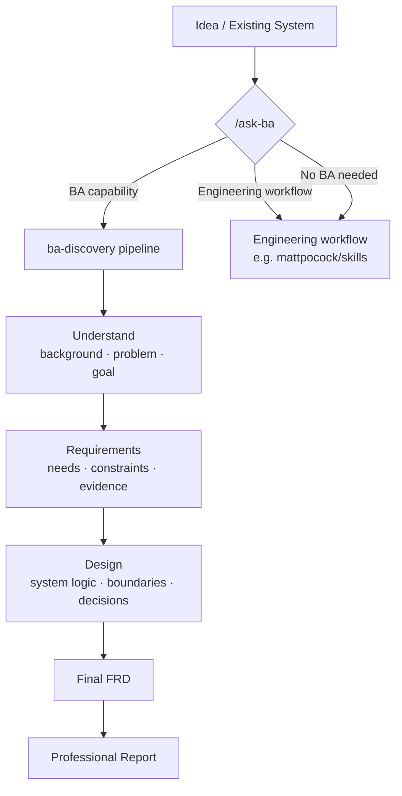

<div align="center">

# BA Discovery

**Get the business right before you ask an agent to build the software.**

A composable Business Analysis skill suite for Claude Code — from fuzzy idea to an approved, traceable Final FRD.

[](CHANGELOG.md)
[](#quick-start)
[](#the-skills)
[](#development--validation)

[English](README.md) | [ไทย](README.th.md)

</div>

---

Coding agents are very good at turning a clear plan into working code. The harder problem is upstream: the problem is still fuzzy, stakeholder and agent mean different things by the same words, scope keeps moving, or design starts before anyone has agreed what success looks like.

BA Discovery helps you move from **background → goal → scope → requirements → system design → FRD**, keeping the reasoning durable in the repo (a **Project Brain**) so another session, agent, or teammate can pick it up without starting over.

It is intentionally **not** a coding workflow. Once the business problem and buildable intent are clear, hand the work to an engineering workflow — this README shows a recommended continuation using [mattpocock/skills](https://github.com/mattpocock/skills).

## Contents

- [Why Start Here?](#why-start-here)
- [How It Works](#how-it-works)
- [The Skills](#the-skills)
- [Quick Start](#quick-start)
- [The Project Brain](#the-project-brain)
- [Change Management](#change-management)
- [What BA Discovery Produces](#what-ba-discovery-produces)
- [Behavioral Confidence](#behavioral-confidence)
- [Optional Companion: ELI5](#optional-companion-eli5)
- [Where BA Discovery Stops](#where-ba-discovery-stops)
- [Design Principles](#design-principles)
- [Repository Layout](#repository-layout)
- [Development & Validation](#development--validation)
- [Credits & Related Work](#credits--related-work)

---

## Why Start Here?

A strong engineering workflow can build the wrong thing extremely well. BA Discovery exists to reduce four failure modes that happen **before** implementation starts.

| # | Failure mode | What BA Discovery does instead |
|---|---|---|
| 1 | **The agent starts solving before it understands** — "we need a better planning system" immediately produces architecture proposals | Starts with the current situation: why the project exists, what is painful today, what outcome matters, what is already true |
| 2 | **The user gets asked questions they cannot meaningfully answer** — stakeholders are forced to pick event sourcing or graph databases | Separates what the stakeholder owns, what the codebase can answer, what needs research, and what engineering should decide later |
| 3 | **Requirements drift across sessions** — a long conversation is not durable project state | Keeps a lightweight Project Brain (`.ba/`) with approved snapshots, so the conversation can end without the project forgetting |
| 4 | **A good spec describes the wrong problem** — precise output, wrong inputs | Focuses on the questions before implementation: why, what outcome, what scope, which decisions are approved vs. still assumptions |

The goal is not fewer conversations. The goal is **fewer redundant or unanswerable conversations**.

---

## How It Works

You can run the whole pipeline or invoke one phase directly. Phases are independent skills — you do not have to do everything in one session.



Every phase writes durable, traceable state into the Project Brain instead of leaving decisions buried in chat history. Phase prerequisites are **soft guards**, not prison bars — if approved requirements already exist from elsewhere, you can start at design; provenance is recorded rather than pretending an earlier phase happened.

### The Skills

| Skill | Use it when |
|---|---|
| `ask-ba` | You are not sure where to start or which BA skill fits the situation |
| `ba-discovery` | You want the pipeline to guide you through multiple BA phases |
| `ba-understand` | The background, real problem, goal, or current state is still unclear |
| `ba-requirements` | You understand the problem and need to discover or validate what the system must do |
| `ba-design` | Requirements are sufficiently understood and you need system logic and design |
| `ba-spec` | The decisions are settled and you want the consolidated Final FRD |
| `ba-report` | You want a professional, ELI5-style project report non-technical readers can follow |
| `ba-change` | Approved truth may need to evolve, an OPEN change needs to resume, or new intent must relate to an existing pending change |

### `/ask-ba` can also tell you to leave BA

`/ask-ba` is not forced to recommend another BA phase. It returns one of three outcomes:

- **BA capability** — meaningful BA uncertainty remains.
- **Engineering workflow** — the business/specification boundary is clear and the next work is implementation planning, coding, testing, review, or handoff.
- **No BA needed** — the request is small, bounded, and sufficiently specified; more BA ceremony would not reduce meaningful uncertainty.

This keeps BA Discovery focused on its real job instead of owning the entire software lifecycle.

---

## Quick Start

Clone or download this repository, then load it as a Claude Code plugin:

```bash
claude --plugin-dir /path/to/ba-discovery
```

The canonical plugin commands are namespaced:

```text
/ba-discovery:ask-ba        /ba-discovery:ba-design
/ba-discovery:ba-discovery  /ba-discovery:ba-spec
/ba-discovery:ba-understand /ba-discovery:ba-report
/ba-discovery:ba-requirements /ba-discovery:ba-change
```

A simple first run:

```text
/ba-discovery:ask-ba
I have an existing planning system, but I am not sure whether I should start from
the problem, the requirements, or the design.
```

Or let the pipeline guide the work:

```text
/ba-discovery:ba-discovery
Take this project through system design, but stop at each approval gate.
```

Or jump straight to one capability:

```text
/ba-discovery:ba-design
Use the approved requirements in docs/requirements.md as the design input.
```

Pause naturally. Resume naturally. The Project Brain is what carries the work forward.

---

## The Project Brain

BA Discovery keeps a lightweight **Project Brain** inside the project being analysed:

```text
.ba/
├── PROJECT.md
├── REQUIREMENTS.md
├── DECISIONS.md
├── RESEARCH.md
├── changes/          # v0.8: pending & applied change records
└── phases/           # approved phase snapshots
```

Four roles keep summaries from silently becoming competing truth:

| Role | Meaning |
|---|---|
| **CANONICAL** | Current project truth: problem, goal, scope, requirements, constraints, decisions |
| **EVIDENCE** | Research/source synthesis that informs decisions but does not automatically become a requirement |
| **DERIVED / NAVIGATION** | Current phase, baselines, coverage, Next Focus — projections, not a second source of truth |
| **HISTORICAL** | Approved phase snapshots showing what was approved at a point in time |

Approved snapshots are append-only. Current truth may evolve, but history is not rewritten to make the project look cleaner.

### Question quality is part of the product

Question design is a core behavior, not a tone preference. The shared **Question Contract** decides who should be asked, whether the answer already exists in artifacts or research, how much explanation is needed, and how the answer is classified before it becomes durable truth.

- **Decision-critical** questions are asked one at a time, so each answer can change the next question.
- Tightly related low-risk facts may be batched in groups of 2–4.
- A stakeholder is never asked to perform expert architecture reasoning they do not own.
- Casual estimates remain estimates until a hard requirement is actually confirmed.
- Progress is qualitative, not a fabricated percentage.

The practical rule: **ask well, then preserve the answer honestly.**

---

## Change Management

`/ba-change` is the single front door for evolving already-approved project truth without letting pending ideas contaminate the current baseline. BA Discovery remains **Single User Only**: the same interactive user provides business intent, clarification, impact confirmation, and final confirmation — roles that exist inside the software being designed do not become additional BA participants.

The state model is intentionally simple:

- **Current canonical** — what is approved and true now.
- **Pending change** — durable working analysis in `.ba/changes/CHG-*.md`; visible when relevant, but not approved truth.
- **Applied change** — why current truth changed.
- **Phase snapshot** — what was approved at an earlier milestone.

Two operating rules keep AI context clean:

> **Stage the change, commit the truth.**
>
> **Current truth for work. History on demand.**

When new intent arrives, BA Discovery reads the actual OPEN change records first (*read before relating*) and compares business intent before deciding whether to extend the same change or create a new one. Impact analysis follows causal evidence, not keyword similarity, and revalidates only knowledge that actually needs to change. Before canonical mutation, the user sees a final **Before → After** summary; deterministic tooling validates the prospective state, applies it, reads it back, and only then marks the change `APPLIED`.

A complete worked example — evolving one fixed MOQ threshold into package-size-dependent behavior as a single coherent change — ships in [`examples/change-managed-moq-planner`](examples/change-managed-moq-planner).

---

## What BA Discovery Produces

The goal is not to generate as many documents as possible, but to leave behind enough **approved, traceable project truth** that downstream agents never have to reconstruct reasoning from chat history.

Typical outputs:

- project background, problem, and goal
- scope and explicit non-goals
- validated requirements and constraints
- material decisions and their rationale
- research findings with provenance
- system logic and design
- approved phase snapshots
- a Final FRD
- an optional professional FRD report for business readers

### The professional report

`ba-report` uses a fixed `BA-ELI5-FRD v1.0` pattern so reports stay familiar across projects. HTML reports start from the fixed `skills/ba-report/assets/report-template.html` shell, keeping typography, callouts, traceability, and print behavior consistent.

<details>
<summary><strong>The 15 report sections</strong></summary>

1. Background
2. Goal
3. What We Will Do
4. Scope & Boundaries
5. Current → Future
6. Project / System Logic
7. Functional Requirements
8. Business Rules & Decision Logic
9. Data & Integrations
10. Roles, Responsibilities & Permissions
11. Exceptions & Edge Cases
12. Non-Functional Requirements
13. Acceptance & Success Criteria
14. Risks, Assumptions & Open Items
15. Technical Reference & Traceability

</details>

The report is a **presentation layer over approved project truth** — it must not invent missing requirements or silently resolve contradictions.

---

## Behavioral Confidence

Structure alone does not prove behavior. BA Discovery ships a vendor-neutral behavioral eval layer for the parts of BA quality structural lint cannot prove. `scripts/ba_eval.py` evaluates normalized run records plus final `.ba/` state **without calling any model API**, and is designed to catch behaviors such as:

- asking the stakeholder for a fact that already exists in project evidence,
- turning uncertain language into confirmed truth,
- fabricating phase approval when entering Design from external approved requirements,
- re-bootstrapping the Project Brain instead of resuming.

The same scenario can be run with Claude Code, Codex, Gemini, or another AI by normalizing exposed events into the shared run-record schema — the core contract is **vendor-neutral**.

> **No vendor-specific feature is required for BA Discovery correctness.**

See [`evals/README.md`](evals/README.md) for manual capture, normalized events, and result statuses. A complete **Brownfield** example is available at [`examples/brownfield-capacity-planner`](examples/brownfield-capacity-planner); deterministic structure checking is covered by `scripts/ba_lint.py` (see [Development & Validation](#development--validation)).

---

## Optional Companion: ELI5

BA Discovery has its own Answerability Gate and question-transformation rules, and `ba-report` produces its standard report on its own. [DreambigOu/ELI5](https://github.com/DreambigOu/ELI5) is **recommended, but not required** — reach for it when approved project truth needs re-explaining to a specific audience:

```text
BA Discovery
Find and preserve the project truth
        │
        ├── /ba-report        standard professional project report
        └── ELI5 (optional)   reframe an approved concept for a specific audience
```

> **BA Discovery finds and preserves the truth. ELI5 helps explain that truth to different people.**

Do not use ELI5 to silently change requirements, decisions, scope, or business rules. If an explanation exposes a real inconsistency, route that discovery back through the appropriate BA phase first.

---

## Where BA Discovery Stops

BA Discovery is deliberately upstream of implementation. Its job is to answer:

> **Are we building the right thing, for the right reason, inside the right boundary?**

Once the answer is stable, the job changes to engineering discipline: domain language, implementation seams, tickets, TDD, code review, and handoff between coding sessions. That is a natural point to continue with [mattpocock/skills](https://github.com/mattpocock/skills). That repository is **not** bundled here — install it separately and use whichever parts fit.

### Recommended routing after the FRD

| Situation | Next step |
|---|---|
| Technical assumptions still need stress-testing against the real codebase | [`/grill-with-docs`](https://github.com/mattpocock/skills/tree/main/skills/engineering/grill-with-docs) |
| Decisions settled, build fits one session | [`/implement`](https://github.com/mattpocock/skills/tree/main/skills/engineering/implement) |
| Decisions settled, build spans multiple sessions | [`/to-spec`](https://github.com/mattpocock/skills/tree/main/skills/engineering/to-spec) → [`/to-tickets`](https://github.com/mattpocock/skills/tree/main/skills/engineering/to-tickets) → `/implement` one ticket at a time |
| Build too large or uncertain for one planning session | [`/wayfinder`](https://github.com/mattpocock/skills/tree/main/skills/engineering/wayfinder) before `to-spec` |
| Changing agent, session, harness, or working directory | [`/handoff`](https://github.com/mattpocock/skills/tree/main/skills/productivity/handoff) — point at durable artifacts (`.ba/PROJECT.md`, Final FRD), not a retelling of the conversation |
| Not sure which engineering skill comes next | [`/ask-matt`](https://github.com/mattpocock/skills/tree/main/skills/engineering/ask-matt) — the router, just as `/ask-ba` routes here |

### The combined workflow

```text
                      BUSINESS ANALYSIS

Idea / Pain / Existing System
            │
            ▼
        BA Discovery
            ├── Background · Goal · Scope
            ├── Requirements · Decisions
            ├── System Design · Final FRD
            ▼
    "Are we building the right thing?"

────────── ENGINEERING BOUNDARY ──────────

            ▼
      mattpocock/skills
            ├── grill-with-docs   optional technical stress-test
            ├── to-spec           preserve settled engineering intent
            ├── to-tickets        split multi-session work
            ├── implement         build with TDD
            ├── code-review       verify standards + spec
            └── handoff           cross agent/session boundaries
            ▼
       Working Software
```

In one sentence: **BA Discovery helps you decide what should be built. `mattpocock/skills` helps you engineer and ship it well.** They overlap just enough to form a useful seam — not enough that either needs to replace the other.

---

## A Realistic Path

A [complete synthetic example](examples/order-allocation-planner) ships with this repository: `.ba/` state, four approved snapshots, and a generated professional report.

You have an old planning application. Planners work around it with SQL and Excel, and everyone has an opinion about the replacement.

1. Start the pipeline — inspect what exists, separate facts from assumptions, clarify scope, produce an approved FRD:

   ```text
   /ba-discovery:ba-discovery
   Take us through the problem, requirements, and system design before we commit to a solution.
   ```

2. The FRD says **what** the new capability must do, but the codebase still needs sharper domain language and technical ADRs:

   ```text
   /grill-with-docs
   ```

3. Technical decisions settled and the build is large:

   ```text
   /to-spec
   /to-tickets
   ```

4. Implement one ticket per fresh session, and hand off across agent boundaries when needed:

   ```text
   /implement #123
   /handoff
   ```

That is the intended relationship: **BA first, engineering second, durable artifacts at the boundary.**

---

## Design Principles

- **Accuracy over speed.** Important conclusions should be traceable to evidence.
- **Do not reinvent the wheel.** Research prior art before inventing a new framework.
- **Ask the right source.** The stakeholder is one information source, not the default source for every question.
- **Make questions answerable.** Translate specialist choices into language the stakeholder can meaningfully answer.
- **Conversation is not waste. Redundant conversation is waste.**
- **Do not fake completed phases.** External input is allowed; its provenance stays visible.
- **Backtrack knowledge, not time.** A later discovery preserves unaffected work and revalidates only the impacted frontier.
- **The Project Brain is durable; the session is disposable.**

---

## Repository Layout

```text
ba-discovery/
├── .claude-plugin/
│   └── plugin.json               # plugin manifest
├── skills/                       # 8 skills (ask-ba → ba-change)
│   ├── ask-ba/
│   ├── ba-discovery/
│   ├── ba-understand/
│   ├── ba-requirements/
│   ├── ba-design/
│   ├── ba-spec/
│   ├── ba-report/                # incl. assets/report-template.html
│   └── ba-change/
├── shared/                       # cross-skill contracts
│   ├── contract-core.md
│   ├── contract-records.md
│   ├── contract-snapshots.md
│   ├── contract-changes.md
│   └── question-contract.md
├── scripts/                      # deterministic tooling (stdlib only)
│   ├── ba_lint.py                # .ba/ structural lint
│   ├── ba_eval.py                # vendor-neutral behavioral eval
│   ├── ba_context.py
│   ├── change_state.py
│   └── ba_change_commit.py
├── evals/                        # behavioral eval layer
│   ├── README.md
│   ├── behavior-contract.md
│   ├── schema/                   # run-record & expectations schemas
│   ├── scenarios/
│   ├── fixtures/                 # good-run / bad-run records
│   └── results/
├── examples/                     # complete synthetic projects
│   ├── order-allocation-planner/
│   ├── brownfield-capacity-planner/
│   └── change-managed-moq-planner/
├── docs/                         # design spec & version verification notes
├── tests/                        # pytest suite + tests/validate_repo.py
├── CHANGELOG.md
├── VERSION
├── README.md
└── README.th.md
```

The `.ba/` Project Brain belongs to the project you are analysing — never to this plugin repository.

---

## Development & Validation

BA Discovery is clone-and-use. All deterministic tooling uses only the Python standard library — no `pip install` required.

```bash
# Structural repo check (manifest, skills, contracts, examples)
python tests/validate_repo.py

# Full test suite (103 tests)
python -m pytest tests/ -q

# Lint a project's .ba/ structure (run inside the analysed project)
python /path/to/ba-discovery/scripts/ba_lint.py
```

`ba_lint.py` checks deterministic `.ba/` structure: duplicate IDs, dangling references, invalid lifecycle/phase values, missing baselines, snapshot naming, approval blocks, and bypass provenance. It is structural validation, **not** a semantic score of whether a requirement is "good". If Python 3 is unavailable, the conversational BA workflow still works, but the agent must not claim structural validation.

---

## Credits & Related Work

BA Discovery is focused on Business Analysis and the pre-implementation boundary. It is designed to compose well with engineering workflows rather than own them. The recommended engineering continuation lives in [mattpocock/skills](https://github.com/mattpocock/skills) — maintained in its own repository, not included here.
